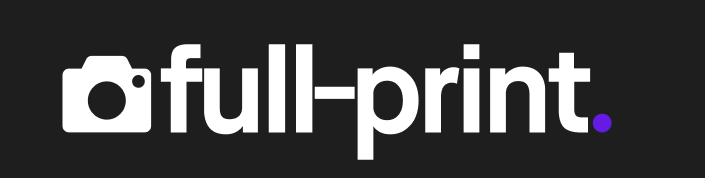
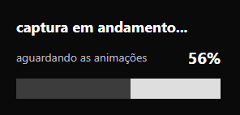

<p align="center">
  
</p>

# full-print.

### Não é só um print. É uma captura inteligente.

**Capture páginas completas, mesmo com animações e conteúdos dinâmicos, em alta resolução 2x.**

O **full-print** é uma extensão para Google Chrome, desenvolvida para capturar páginas web completas com maior fidelidade visual, inclusive aquelas que utilizam animações, efeitos de rolagem e carregamento dinâmico.

O projeto nasceu de um problema real: capturar uma landing page com GSAP e ScrollTrigger sem perder elementos, gerar áreas vazias ou registrar animações incompletas.

A proposta é simples: **um clique, uma captura inteligente e o resultado pronto para exportação.**

## Por que full-print?

Extensões tradicionais de captura de página inteira podem apresentar dificuldades com conteúdos que dependem da rolagem.

O full-print utiliza o Chrome DevTools Protocol (CDP) e estratégias adaptativas de preparação da página para reduzir esses problemas, preservando a composição visual sempre que possível.

## Principais funcionalidades

### Captura inteligente

O full-print analisa o comportamento da página para selecionar uma estratégia de captura adequada.

Em páginas dinâmicas, pode percorrer o conteúdo, ativar elementos dependentes do scroll e aguardar a estabilização das animações antes de capturar.

### Alta resolução 2x

A extensão prioriza uma resolução mínima de **2x por dimensão**, equivalente a quatro vezes mais pixels que uma captura de referência em 1x.

Quando necessário, utiliza captura por faixas para preservar a resolução em páginas extensas, respeitando os limites do ambiente.

### Exportação em PNG e PDF

Após a captura, uma nova aba apresenta a pré-visualização completa, com opções para:

- Copiar imagem
- Salvar PNG
- Salvar PDF


### Captura com um clique

Sem configurações obrigatórias. Basta clicar no ícone da extensão para iniciar a captura completa da página.

### Interface minimalista

Identidade visual própria, feedback de progresso e controles simplificados.

<p align="center">
  
</p>

## Tecnologias

- TypeScript
- Chrome Extension Manifest V3
- Chrome DevTools Protocol (CDP)
- Chrome Debugger API
- HTML e CSS
- Vite

## Como funciona

1. O usuário inicia a captura pelo ícone da extensão.
2. O full-print analisa a página e identifica a estratégia apropriada.
3. Quando necessário, prepara animações e conteúdos dinâmicos.
4. Captura a página em alta resolução.
5. Abre uma nova aba para pré-visualização e exportação.

## Instalação para desenvolvimento

Clone o repositório e instale as dependências:

```bash
npm install
npm run build
```

Depois:

1. Abra `chrome://extensions`.
2. Ative o **Modo do desenvolvedor**.
3. Clique em **Carregar sem compactação**.
4. Selecione a pasta de build gerada pelo projeto.

## Compatibilidade e limitações

O full-print foi desenvolvido inicialmente para Google Chrome, com potencial de compatibilidade com outros navegadores baseados em Chromium.

Determinadas animações complexas, iframes de outros domínios e páginas protegidas podem apresentar limitações.

Como utiliza a API `chrome.debugger`, o Chrome pode apresentar temporariamente um aviso de depuração durante a captura.

Os PDFs exportados são baseados em imagens e não oferecem necessariamente texto selecionável.

## Status do projeto

**Em desenvolvimento — v0.6.0**

O mecanismo principal de captura está funcional, com testes automatizados e validações manuais realizadas. A compatibilidade com diferentes sites e a preparação para publicação continuam em evolução.

## A origem do projeto

O full-print começou como um experimento pessoal de UX/UI e desenvolvimento.

A necessidade era capturar uma landing page com animações GSAP e ScrollTrigger, algo que as ferramentas tradicionais não conseguiam reproduzir adequadamente naquele cenário.

O desafio evoluiu para uma extensão dedicada à captura inteligente, combinando fidelidade visual, alta resolução e uma experiência simplificada.

---

**full-print — Não é só um print. É uma captura inteligente.**
